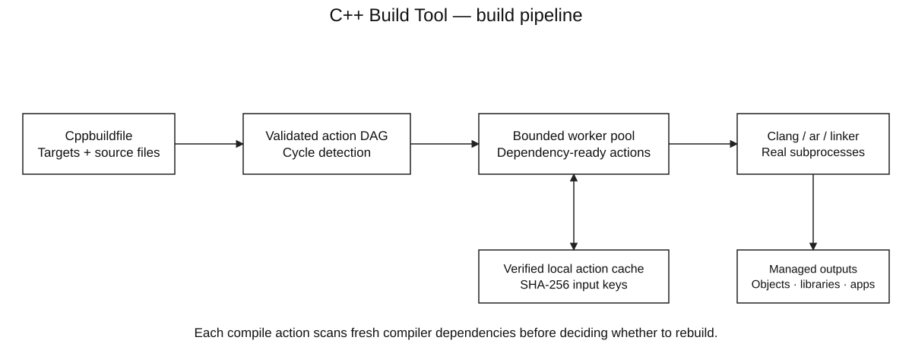
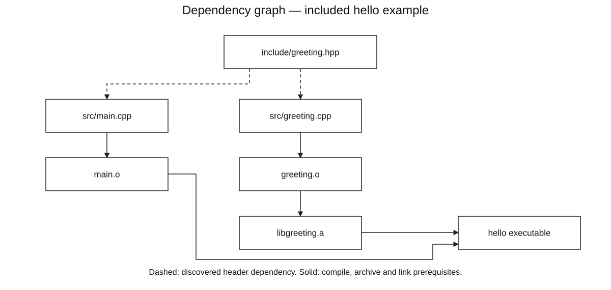
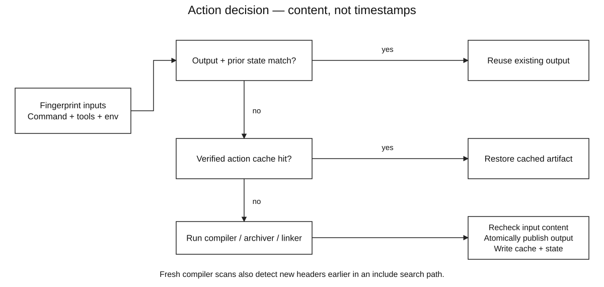

# C++ Build Tool

A C++17 **incremental build tool** that compiles and links real C++ programs. It discovers headers through the compiler, schedules dependency-ready actions across bounded workers, and reuses or restores artifacts using SHA-256 content keys.

**Dependency DAG · topological scheduling · cycle detection · content hashing · verified action cache · parallel subprocesses · failure propagation · atomic output publication**

The tool orchestrates Clang/GCC-compatible drivers and a POSIX archiver. It does not implement a C++ compiler. The implementation uses the standard library and POSIX APIs; Python's standard library supplies integration tests and measurement tooling. No GPU, external database or package installation is required.

## Architecture



A manifest declares programs, static libraries, sources and library dependencies. The tool validates target dependencies, creates compile/archive/link actions, then executes actions only after their prerequisites succeed. Independent translation units can run concurrently.

### Dependency graph



Compiler-generated dependency files identify actual transitive includes, including system headers. Before every selected compile action, a fresh dependency scan detects changes such as a newly added header earlier in the include search path. The action graph schedules object/archive/link steps; header files are fingerprinted inputs, not separately runnable tasks.

### Reuse, restore or rebuild



Keys include the logical command, source/header or artifact content, executable tool fingerprints and an environment digest. Existing outputs are hashed before reuse. Cache artifacts are verified before restoration. New outputs are staged separately, checked against input changes, then published by atomic replacement; a failed compile leaves its previous object/executable intact.

### From edit to executable

1. Read `Cppbuildfile`, validate paths and reject dependency cycles before compiler work.
2. Select a program/library and its dependency closure; create shared object actions once per source.
3. Scan fresh compiler dependencies for each selected source and hash its actual inputs.
4. Reuse valid output, restore a verified cache hit, or run the real build command.
5. Release dependent actions as prerequisites succeed. A failed action blocks its dependents; `--keep-going` can complete independent branches.
6. Write a JSON report with action reasons, command counts, cache decisions, timings and peak active workers.

See [architecture and invariants](docs/ARCHITECTURE.md), [How to run](docs/HOW_TO_RUN.md), and the [editable draw.io sources](docs/DIAGRAMS.md).

## Build

Requirements: **C++17**, `make`, a Clang/GCC-compatible C++ driver and POSIX tools. Python 3 is required only for integration tests and benchmarks. Executed on macOS Apple Silicon with Apple Clang 21. Linux/WSL instructions are provided but have not been executed here. Native Windows/MSVC support is not implemented.

On macOS, install compiler tools if needed:

```sh
xcode-select --install
```

From this project directory:

```sh
make
./build/cppbuild --help
make test
```

On Ubuntu/Linux, install the prerequisites first:

```sh
sudo apt update
sudo apt install build-essential clang python3
```

On Windows, install WSL2/Ubuntu from administrator PowerShell, then use the Linux commands inside Ubuntu:

```powershell
wsl --install -d Ubuntu
```

Keep the checkout and generated artifacts in the Linux filesystem. There are no third-party C++ dependencies to install. An up-to-date `make` may say `Nothing to be done`.

## Try the included project

```sh
make demo
```

This uses the new tool to build `examples/hello`, archives a static library, links an executable, then runs it:

```text
Hello from C++ Build Tool
```

The tool is `build/cppbuild`. The example's generated executable is `examples/hello/.cppbuild/bin/hello`. To inspect its actions:

```sh
./build/cppbuild build --file examples/hello/Cppbuildfile --jobs 4 --explain
./build/cppbuild graph --file examples/hello/Cppbuildfile
./build/cppbuild graph --file examples/hello/Cppbuildfile --json
```

Repeat a build without edits to see `up_to_date`; it still performs compiler dependency scans. Edit `examples/hello/src/greeting.cpp` to change the greeting, or edit its header to invalidate its consumers. `--explain` shows each action's reuse/rebuild reason. The default target is the first program, or first library when no program is declared.

## Define your own project

Create a `Cppbuildfile` in the project root:

```text
compiler "clang++"
flags "-std=c++17" "-O2" "-Wall" "-Wextra"
includes "include"

library "math"
sources "src/math.cpp"

program "app"
sources "src/main.cpp"
depends "math"
```

Then run the built tool from that root, or select the manifest with `--file`:

```sh
/path/to/cppbuild build app --jobs 4 --explain
./.cppbuild/bin/app
```

Project settings precede targets. Arguments are double-quoted strings, and `#` starts a comment outside quotes. `depends` names static libraries; transitive libraries are linked after their dependents. Source/include paths are relative to the manifest and must stay within its project root. Commands use argument vectors, preserving spaces and shell metacharacters without a shell.

All outputs live in the owned `.cppbuild/` directory. It should be ignored by Git and treated as generated data. A manifest selects executable tools and flags, so only run manifests you trust. See the [manifest and CLI reference](docs/HOW_TO_RUN.md) for details and supported limits.

## Cache and failure behavior

```sh
./build/cppbuild clean --file examples/hello/Cppbuildfile
./build/cppbuild build --file examples/hello/Cppbuildfile --json
./build/cppbuild clean --file examples/hello/Cppbuildfile --all
```

`clean` removes generated outputs/state/logs but retains the action cache; the next build can restore artifacts without compilation. `clean --all` also removes cached actions. The owner marker and lock remain. Cleaning refuses unrecognized or redirected managed directories.

Content changes invalidate actions even when file size and mtime are unchanged. A timestamp-only edit does not require recompilation. Corrupt/missing outputs are restored from a verified cache entry or rebuilt; corrupt cache entries are not trusted. Cache storage is local and has no automatic eviction, so use `clean --all` when reclaiming space.

SIGINT/SIGTERM requests cancellation. Pending work is blocked, running compiler process groups receive SIGTERM, and groups that remain are sent SIGKILL after one second. The CLI returns 130. Cancellation cannot undo work already committed by another independent action. Failed or cancelled builds do not link through failed prerequisites.

## Algorithms and data structures

| Component | Structure / algorithm | Purpose / cost |
|---|---|---|
| Target/action dependencies | Adjacency lists | O(V + E) graph storage |
| Cycle detection and ordering | Kahn topological traversal + min-priority ready queue | O(E + V log V); deterministic index tie-breaking |
| Parallel scheduler | Prerequisite counts + reverse edges + ready heap | Release an action when all prerequisites succeed |
| Failure propagation | Iterative descendant traversal | Block affected pending actions without recursion through compiler jobs |
| Shared object actions | Path-to-node ordered map | Compile each selected source once under project-wide flags |
| Action identity | SHA-256 over length-delimited fields | Content-aware invalidation without trusting timestamps |
| Dependency inputs | Sorted path set | Deduplicate compiler-reported source/header paths |
| Local cache | Digest-keyed directories + verified artifact hashes | Reuse across output cleaning and source-version reversions |

Limits: 256 targets, 4,096 distinct sources, 1–32 workers, 1 MiB manifest, 8 MiB compiler dependency file, and 1 MiB captured diagnostics per subprocess. Excess diagnostic bytes are drained so a verbose compiler cannot block on an unread pipe. The source/header hashing loop uses a 64 KiB read buffer; compiler memory and OS buffers are separate costs.

## Tests and observations

```sh
make test
make sanitize
make benchmark
```

Tests cover SHA-256 vectors, seeded DAGs, parallel ordering, failure propagation, dependency-file escapes, real compilation/linking, same-mtime edits, transitive and shadowing headers, static-library diamonds, cache corruption/restoration, command changes, paths with spaces/metacharacters, locking, cancellation, bounded diagnostics and safe cleaning.

`make benchmark` builds a real 13-translation-unit fixture and checks executable output after full, unchanged, leaf-header, shared-header and cache-restore builds. It records actual command counts and end-to-end times. See the [measured report](docs/PERFORMANCE_REPORT.md), [raw batches](docs/benchmarks/latest.json), and [test coverage](docs/TESTING.md).

**No claim to outperform make or Ninja:** this design deliberately performs fresh compiler dependency scans and content/tool hashing. Those checks cost time, especially for small/no-op builds. Its purpose is an inspectable build engine with explicit correctness and resource choices; comparative performance needs a separate controlled benchmark.

## Scope and limits

This is a static-library/executable build tool for stable, trusted local source trees. It supports project-wide compile/link settings, not arbitrary shell recipes, code generation, shared libraries, modules, package resolution, cross-machine execution or a file watcher. Generated headers must already exist before a build. Flags that override managed output/dependency handling and response files are rejected.

The cache is not fully hermetic: system linker libraries, compiler plugins, wrapper internals and nondeterministic inputs such as time macros are not comprehensively modeled. System headers are discovered and hashed; tool binaries/version output and most environment entries participate, but complete toolchain isolation would require a broader design. Files are read individually rather than as a coordinated filesystem snapshot; keep sources stable during builds. Detected input/dependency changes during compilation reject publication, but concurrent edits can always require another build.

Caches contain object files, libraries, executables and diagnostics, potentially including sensitive source-derived data. Do not publish `.cppbuild/`. Moving a project with that directory requires recreating the generated workspace because its owner marker records the canonical project root. No database migration, production remote-cache security or power-loss certification is claimed.

## Code style

Small concrete types, explicit ownership, descriptive names and comments explaining difficult edge cases. The scheduler owns graph state under a mutex; compiler processes run outside it. There is no custom async framework or simulated task time. `.clang-format` records C++ formatting. Application output and public documentation are English; private study notes are ignored by Git.

## Repository map

```text
include/cppbuild/build.hpp Public project, graph, process and report types
include/cppbuild/hash.hpp  Streaming SHA-256
src/project.cpp           Manifest parsing, dependency parsing and graphs
src/process.cpp           Argument-safe subprocesses and cancellation
src/build.cpp             Scheduler, verified cache, locking and publication
src/main.cpp              CLI and signal setup
tests/unit.cpp            SHA, graph and scheduler checks
tests/integration.py      Actual compiler/filesystem failure-path tests
scripts/benchmark.py      Checked real-build observations
examples/hello/           Small program plus static library
docs/                     Run guide, design, tests and diagrams
```
